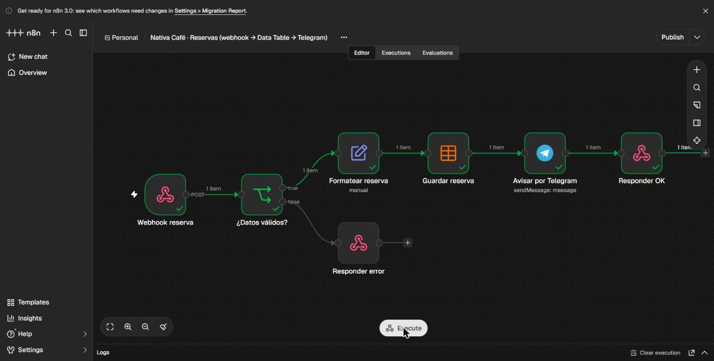
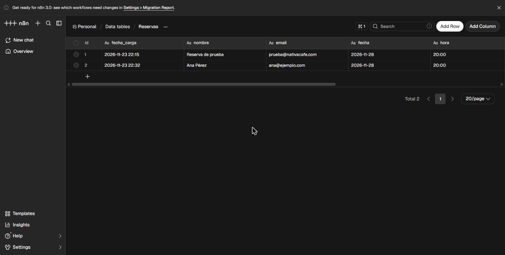

# Automatización de reservas con n8n

Flujo de n8n que recibe las reservas del formulario de [Nativa Café](https://nativa-cafe.vercel.app), las guarda en una Data Table de n8n y avisa al dueño del local por Telegram. Es un proyecto de portafolio con un negocio ficticio.

```
Formulario web ──POST──▶ Webhook ──▶ ¿Datos válidos? ──sí──▶ Formatear ──▶ Data Table ──▶ Telegram ──▶ Responde 200
                                              └──no──▶ Responde 400 con el error
```

## Qué resuelve
Un local chico recibe reservas por la web y alguien tiene que copiarlas a mano a una planilla y avisar al encargado. Con este flujo, cada reserva queda registrada sola y el dueño recibe un mensaje al instante.

## Nodos
| Nodo | Qué hace |
| --- | --- |
| Webhook reserva | Recibe `POST /webhook/reservas` con `name, email, date, time, people` |
| ¿Datos válidos? | Revisa que haya nombre, email con `@` y fecha |
| Formatear reserva | Arma las columnas y agrega la hora de carga (zona America/Asuncion) |
| Guardar reserva | Agrega una fila en la Data Table `Reservas` (tabla interna de n8n, no necesita cuentas externas) |
| Avisar por Telegram | Manda el resumen de la reserva al chat del dueño |
| Responder OK / error | Devuelve JSON al formulario (200 o 400) |

## Cómo probarlo
1. Iniciá n8n (`n8n start`) y abrí http://localhost:5678.
2. Importá `workflow-reservas.json` (menú ⋯ → Import from file).
3. En n8n creá una Data Table llamada `Reservas` con las columnas `fecha_carga, nombre, email, fecha, hora` (texto) y `personas` (número), y elegila en el nodo **Guardar reserva**.
4. Creá un bot con @BotFather en Telegram, cargá el token como credencial y poné tu chat ID en el nodo de Telegram.
5. Activá el flujo y probalo:

```powershell
Invoke-RestMethod -Method Post -Uri http://localhost:5678/webhook-test/reservas -ContentType 'application/json' -Body '{"name":"Ana Pérez","email":"ana@ejemplo.com","date":"2026-12-05","time":"10:30","people":2}'
```

## Capturas




## Tecnologías
n8n · Webhooks · n8n Data Tables · Telegram Bot API

Hecho por [William Zarza](https://github.com/williamzarza2003).
